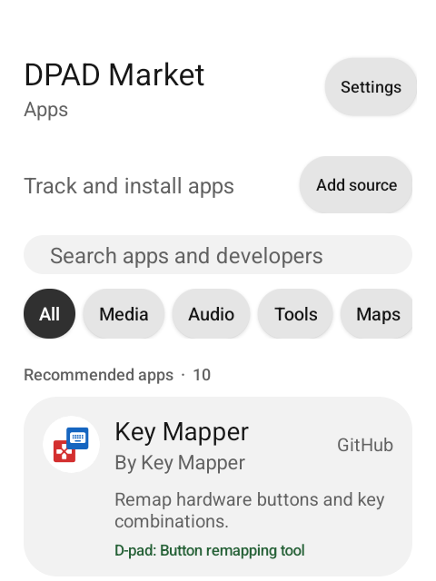
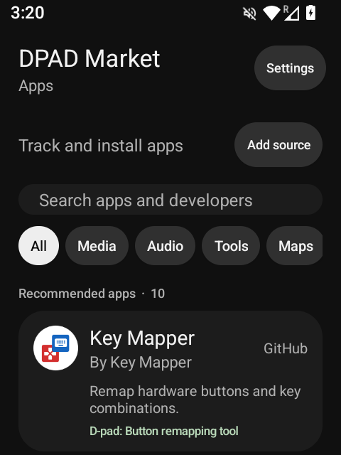
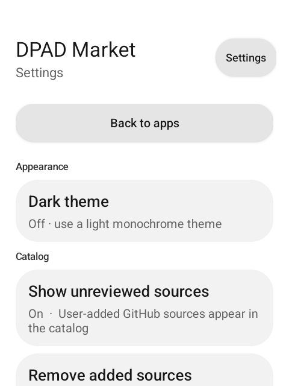
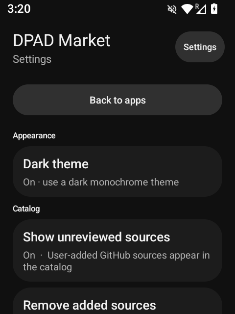

# DPAD Market

<p align="center">
  <strong>A focused app catalog for button-first Android devices.</strong><br />
  Browse useful apps, inspect their upstream releases, and install them with Android's own package installer.
</p>

<p align="center">
  <a href="https://github.com/jbriones95/DPADmarket/releases/latest"></a>
  <a href="https://github.com/jbriones95/DPADmarket/actions/workflows/release.yml"></a>
  <a href="LICENSE"></a>
  <a href="https://developer.android.com/"></a>
</p>

DPAD Market is designed for flip phones, keypad phones, e-ink devices, and
other Android hardware where a touchscreen-first app store is a poor fit. The
interface is intentionally simple, high-contrast, and fully navigable with a
D-pad or keyboard.

## What it does

- Curates Android apps that are useful on button-first devices.
- Fetches the latest release directly from each app's GitHub repository.
- Shows D-pad compatibility, license, platform, package ID, and curator notes.
- Loads repository screenshots dynamically on an app's detail page when the
  upstream README provides them.
- Lets users add public GitHub repositories that publish direct APK releases.
- Hands installation and confirmation to Android's `PackageInstaller`.
- Supports light and dark monochrome themes.
- Checks for DPAD Market updates from GitHub Releases.

## Screenshots

<p align="center">
  
  
  
  
</p>

## Download

Download the latest signed APK from [GitHub Releases][releases]. Open it on
your Android device and confirm installation. Android may ask you to allow
installs from your browser or file manager.

Releases are built and signed by GitHub Actions. Each release includes a
SHA-256 checksum and GitHub build provenance. After installation, updates can
also be checked from **Settings -> Check for DPAD Market updates**.

## How the catalog works

The app fetches the complete catalog from
[`catalog.remote.json`](catalog.remote.json) on the DPAD Market GitHub
repository, validates it, and caches it locally on launch. The bundled catalog
file is intentionally empty and schema-valid, so all curated app listings are
remote and new catalog entries do not require a new APK release.

When an app's details are opened, DPAD Market requests its public GitHub
`releases/latest` endpoint and presents the current release and APK asset.

Screenshots are not copied into this repository. The detail page reads the
linked repository's README through GitHub, finds image references, and loads
them on demand. If a repository has no usable screenshots, the section is
omitted automatically.

Users can also add any public GitHub repository with a direct APK release.
Those entries stay local to the device and are clearly marked as unreviewed.

## Safety model

DPAD Market is a catalog and installer, not a security audit.

- Every listing exposes its upstream repository and declared package ID.
- Remote catalogs must pass schema, duplicate-ID, and GitHub URL validation.
- Curated APKs must match the package ID in catalog metadata.
- Downloads come from GitHub over HTTPS.
- Published GitHub SHA-256 asset digests are checked when available.
- Android controls install confirmation and signing-certificate compatibility.
- User-added sources are visibly unlisted and unreviewed.

Release hashes are not pinned in the catalog, and upstream source is not audited
by DPAD Market. The app calls out those limits rather than implying trust it
cannot provide.

## Build locally

Requirements:

- Android SDK Platform 36
- JDK 17 or newer

Build a debug APK:

```sh
./gradlew assembleDebug
```

The APK is written to
`app/build/outputs/apk/debug/app-debug.apk`.

Release builds are performed by GitHub Actions when a `v*` tag is pushed. The
workflow expects `ANDROID_KEYSTORE_PATH`, `ANDROID_KEYSTORE_PASSWORD`,
`ANDROID_KEY_ALIAS`, and `ANDROID_KEY_PASSWORD` in its environment; the public
workflow supplies them from repository secrets.

## Add an app

Open a pull request that adds metadata to `catalog.remote.json`. New listings
in that file are delivered through the remote catalog and are not embedded in
the APK. A proposed listing
should include:

- A public GitHub repository with a direct APK release asset.
- The verified Android package ID and SPDX license.
- An accurate category, summary, and D-pad support note.
- `apkAsset` when a release has multiple APK choices and one should be preferred.
- `Needs device testing` when compatibility has not been checked on hardware.

A listing is a curator recommendation, not a security audit.

## License

DPAD Market is available under the [MIT License](LICENSE).

[releases]: https://github.com/jbriones95/DPADmarket/releases/latest
